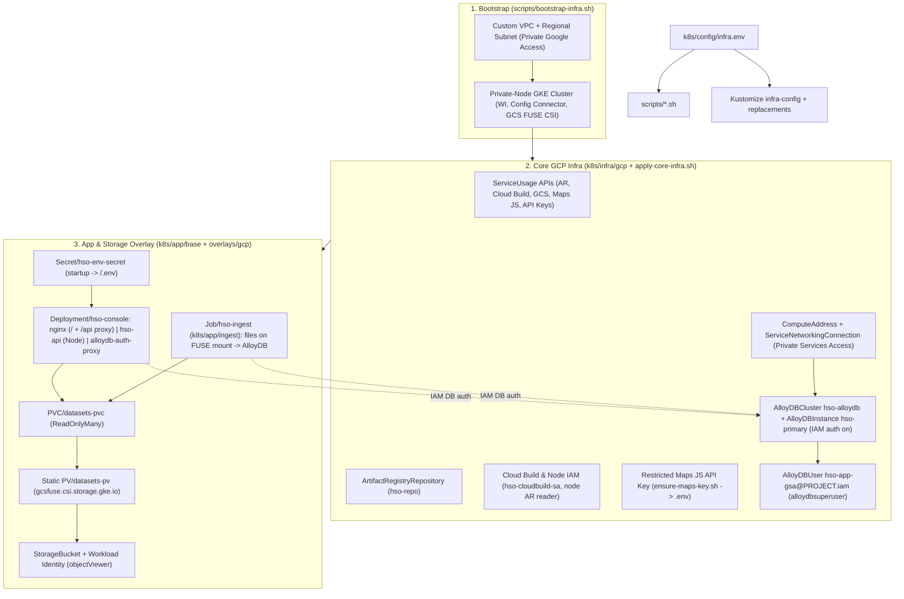

# Infrastructure Architecture & App Contract

This document describes the infrastructure layout, how static frontend assets and datasets are wired at runtime, and common deployment pitfalls to avoid when building your application in `src/`.

## Architecture Overview

1. **Single-source configuration:** Local `k8s/config/infra.env` (copied from `k8s/config/infra.env.example`) feeds both `scripts/*.sh` and Kustomize (`k8s/config/kustomization.yaml` `configMapGenerator` + `replacements`), avoiding hardcoded project IDs or regions in manifests.
2. **Cloud-agnostic workload base:** `k8s/app/base` uses only standard Kubernetes primitives (`Deployment`, `Service`, `ServiceAccount`, `PersistentVolumeClaim`) so the workload stays portable across GKE and hybrid/air-gapped Kubernetes targets (such as Google Distributed Cloud). All GCP-specific resources live in `k8s/infra/gcp` and `k8s/app/overlays/gcp`.
3. **Declarative GCP management:** After cluster bootstrap, Config Connector reconciles GCP APIs, Artifact Registry, Cloud Storage, AlloyDB (PSA peering, cluster, instance, IAM user), Service Accounts, and least-privilege IAM directly from Kubernetes manifests.
4. **Passwordless data tier:** AlloyDB is private-IP only on the bootstrap VPC. The app pod reaches it through an AlloyDB Auth Proxy sidecar using Workload Identity + IAM database authentication; no DB credentials are stored anywhere.

## Runtime Contract for Your Application (`src/`)

Both GKE (`Dockerfile` + Nginx, forwarded to `http://localhost:8090` via `scripts/port-forward.sh`) and local development (`scripts/run-local.sh` on `http://localhost:8080`) expose the exact same HTTP layout to browser code:

| HTTP Path | GKE Source | Localhost Source (`run-local.sh`) | Notes |
| :--- | :--- | :--- | :--- |
| `/` (`index.html`, JS, CSS) | `COPY src/ /usr/share/nginx/html/` | `./src/*` | `Dockerfile` copies `src/` directly into Nginx without a bundler build stage. |
| `/.env` | Generated at container startup from `Secret/hso-env-secret` | `./.env` (auto-provisioned via `ensure-maps-key.sh` if `infra.env` exists) | Contains `GOOGLE_MAPS_API_KEY=<key>`. Fetch at runtime rather than hardcoding keys in HTML/JS. |
| `/datasets/<file>` | Read-only GCS FUSE mount (`gs://<PROJECT_ID>-datasets/`) | `./datasets/<file>` (`Cache-Control: no-store`) | Datasets can be added or updated via `scripts/upload-datasets.sh` without rebuilding the image or restarting pods. |
| `/api/*` | nginx `proxy_pass` -> `hso-api` container (`:8080`) -> AlloyDB via Auth Proxy | *(not served; use `DATA_SOURCE=file`)* | JSON endpoints: `/api/health`, `/api/datasets`, `/api/timeline-bounds`, `/api/wlc-events`, `/api/radar-tracks`, `/api/road-traffic`, `/api/collar-telemetry`, `/api/forum-threads`. See `docs/architecture/data-access.md`. |

`/.env` also carries `DATA_SOURCE=alloydb|file` (default `alloydb` in GKE via `deploy-app.sh`; absent/`file` locally), which selects the frontend's `DataReader` implementation.

## Infrastructure & Packaging Pitfalls

- **Do not try to fetch `incident_briefing.md` at runtime:** `incident_briefing.md` lives at the repo root as human/developer reference context and is intentionally excluded by `.dockerignore` and `.gcloudignore`. It is never deployed to Nginx or GCS.
- **Add a multi-stage `Dockerfile` if you introduce a bundler:** The default `Dockerfile` serves `src/` directly as native ES modules/static assets. If you scaffold a TypeScript/Vite/React build, compile static build artifacts in a Node builder stage and copy the built output (not raw `.ts`/`.jsx` sources) into `/usr/share/nginx/html/`, while keeping `./src` (or updating `scripts/run-local.sh`) consistent for local dev.
- **Do not put quotes or inline comments in `k8s/config/infra.env`:** Kustomize `configMapGenerator` (`envs:`) parses `KEY=VALUE` literally—quotes become part of GCP resource names and break deployment.
- **Watch static file permissions (`HTTP 403 Forbidden` in Nginx):** Files created locally with restrictive modes (`0600`/`0640`) retain those permissions during `docker build` unless normalized (`chmod -R a+rX /usr/share/nginx/html`), and GCS FUSE mounts require `uid=101,gid=101` + `implicit-dirs` (`k8s/app/overlays/gcp`) so Nginx worker processes can read bucket objects.
- **Never bake `.env` or `datasets/` into container layers:** Keep both excluded in `.dockerignore` and `.gcloudignore` so API keys stay in Kubernetes Secrets and large datasets stay on the mounted volume.
- **Always tear down with `scripts/teardown-infra.sh`:** Deleting namespaces or parent buckets before child Config Connector `IAMPolicyMember` resources finish reconciling causes finalizer deadlocks; `teardown-infra.sh` deletes workloads, child IAM bindings, parent resources, the managed Maps API key, and cluster networking in dependency order.
