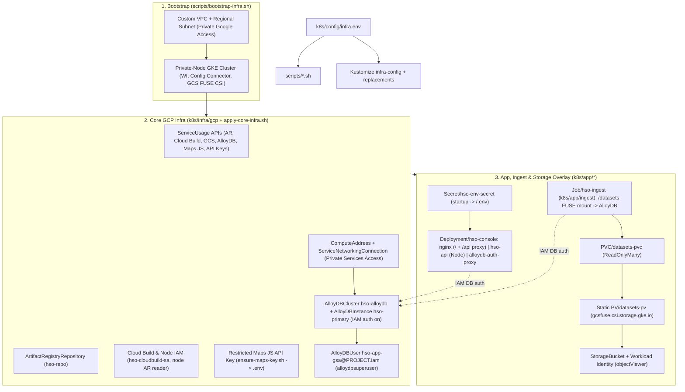

# Infrastructure Architecture & App Contract

This document describes the pre-wired GKE + AlloyDB infrastructure, the runtime HTTP/volume contract exposed to your code in `src/` and `api/`, and deployment pitfalls to avoid.

## Architecture Overview

1. **Single-source configuration:** Local `k8s/config/infra.env` (copied from `k8s/config/infra.env.example`) feeds both `scripts/*.sh` and Kustomize (`k8s/config/kustomization.yaml` `configMapGenerator` + `replacements`), avoiding hardcoded project IDs or regions in manifests.
2. **Cloud-agnostic workload base:** `k8s/app/base` uses only standard Kubernetes primitives (`Deployment`, `Service`, `ServiceAccount`, `ConfigMap`, `PersistentVolumeClaim`) so the workload stays portable across GKE and hybrid/air-gapped Kubernetes targets (such as Google Distributed Cloud). All GCP-specific resources live in `k8s/infra/gcp` and `k8s/app/overlays/gcp`.
3. **Declarative GCP management:** After cluster bootstrap, Config Connector reconciles GCP APIs, Artifact Registry, Cloud Storage, AlloyDB (PSA peering, cluster, instance, IAM user), Service Accounts, and least-privilege IAM directly from Kubernetes manifests.
4. **Passwordless data tier:** AlloyDB is private-IP only on the bootstrap VPC. Both the serving pod (`Deployment/hso-console`) and the one-shot ingest Job (`Job/hso-ingest`) reach AlloyDB through an AlloyDB Auth Proxy sidecar using Workload Identity + IAM database authentication; no database passwords exist anywhere.

## Runtime Contract for Your Application (`src/` & `api/`)

Both GKE (`Dockerfile` + Nginx, forwarded to `http://localhost:8090` via `scripts/port-forward.sh`) and local development (`scripts/run-local.sh` on `http://localhost:8080`) expose the same browser HTTP layout:

| Surface | GKE Source | Localhost Source (`run-local.sh`) | Notes |
| :--- | :--- | :--- | :--- |
| `/` (`index.html`, JS, CSS) | `COPY src/ /usr/share/nginx/html/` | `./src/*` (`Cache-Control: no-store`) | `Dockerfile` copies `src/` directly into Nginx without a bundler build stage. |
| `/.env` | Generated at container startup from `Secret/hso-env-secret` | `./.env` (auto-provisioned via `ensure-maps-key.sh` if `infra.env` exists) | Contains `GOOGLE_MAPS_API_KEY=<key>`. Fetch at runtime rather than hardcoding keys in HTML/JS. |
| `/api/*` | Nginx `proxy_pass` -> `hso-api` (`:8080`) -> AlloyDB via Auth Proxy (`127.0.0.1:5432`) | Proxied to `API_ORIGIN` (`http://127.0.0.1:3000` default; override with `--api`) | `GET /api/health` is pre-wired in `api/server.js`. Add dataset query endpoints here. |
| `/datasets` (Ingest Job only) | Read-only GCS FUSE mount on `Job/hso-ingest` (`gs://<PROJECT_ID>-datasets/`) | `./datasets/` (default `DATASETS_DIR` in `api/ingest.js`) | Raw dataset files are staged via `scripts/upload-datasets.sh` and loaded into AlloyDB via `scripts/ingest-datasets.sh` (not exposed over HTTP by Nginx). |

## Infrastructure & Packaging Pitfalls

- **Do not try to fetch `incident_briefing.md` at runtime:** `incident_briefing.md` lives at the repo root as developer/analyst reference context and is intentionally excluded by `.dockerignore` and `.gcloudignore`.
- **Keep `api/package-lock.json` in sync when adding Node packages:** `api/Dockerfile` runs `npm ci --omit=dev`, which fails if `package.json` and `package-lock.json` diverge.
- **Add a multi-stage `Dockerfile` if you introduce a frontend bundler:** The root `Dockerfile` serves `src/` directly as native ES modules/static assets. If you scaffold a TypeScript/Vite/React build, compile static artifacts in a Node builder stage and copy the built output (not raw `.ts`/`.jsx` sources) into `/usr/share/nginx/html/`.
- **Do not put quotes or inline comments in `k8s/config/infra.env`:** Kustomize `configMapGenerator` (`envs:`) parses `KEY=VALUE` literally—quotes become part of GCP resource names and break deployment.
- **Watch static file permissions (`HTTP 403 Forbidden` in Nginx):** Files created locally with restrictive modes (`0600`/`0640`) retain those permissions during `docker build` unless normalized (`chmod -R a+rX /usr/share/nginx/html`), and the GCS FUSE `PersistentVolume` sets `uid=1000,gid=1000` + `implicit-dirs` (`k8s/app/overlays/gcp/pv.yaml`) so the `node` user in `Job/hso-ingest` can read bucket objects.
- **Never bake `.env` or `datasets/` into container layers:** Keep both excluded in `.dockerignore` and `.gcloudignore` so API keys stay in Kubernetes Secrets and raw datasets stay in GCS.
- **Always tear down with `scripts/teardown-infra.sh`:** Deleting namespaces or parent resources before child Config Connector `IAMPolicyMember` / `AlloyDBInstance` objects finish reconciling causes finalizer deadlocks; `teardown-infra.sh` removes workloads, child IAM bindings, AlloyDB resources, parent buckets/repos, the managed Maps API key, and cluster networking in dependency order.
